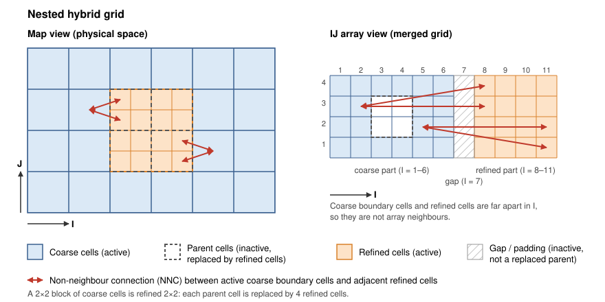

.. _nested_hybrid_grids:

Nested hybrid grids
===================

.. admonition:: Experimental
   :class: warning

   Support for nested hybrid grids is under active development. Several grid
   operations are known to give wrong results on them, see
   :ref:`nhg_known_issues`. Post-processing tools that are not aware of the
   NNC-connected merged grid may also fail.

.. contents:: Table of Contents
   :local:
   :depth: 2

Definition
----------

A **nested hybrid grid** (NHG) is a single corner-point grid where a selected
region of a *coarse* grid has been replaced by a *refined* (subdivided) sub-grid.
The two parts are merged into one grid and need to be connected through
Non-Neighbour Connections (NNCs).

Key properties of a merged nested hybrid grid:

* The cells belonging to the original coarse grid are referred to as **parent**
  cells (also called *mother* cells, as in the NNC table). The original coarse
  cells that were refined remain in the grid but are **inactive**, since the
  refined cells occupy their space.
* The merged grid also contains other inactive cells, such as gaps and padding
  added during merging. These are *not* replaced parents and may need different
  treatment. Inactive refined cells filling up the bounding box of the refined
  grid are another example; they can for instance cause holes in surfaces
  averaged from the grid.
* Coarse and refined cells can touch in physical space without being neighbours
  in the I/J/K array. Refined cells may overlap coarse parent cells
  geometrically while having distant ``(I, J)`` indices.
* Flow across the refinement boundary is described by an NNC table, not by
  I/J/K adjacency.

   Sketch of a nested hybrid grid in map view (left) and in IJ array view
   (right). A block of coarse cells is replaced by refined cells, and the two
   parts are linked by NNCs. In the merged grid the refined cells have I/J
   indices far from their parent cells.

.. note::

   This is different from the *vertical hybrid grid* made by
   :meth:`xtgeo.Grid.convert_to_hybrid`, which only changes the layering within
   a region and does not create a refined sub-grid.

Creating a nested hybrid grid
-----------------------------

Nested hybrid grids are created by the ``fmu.tools.nestedhybridgrid`` module in
`fmu-tools <https://equinor.github.io/fmu-tools/nestedhybridgrid.html>`_ (also
experimental), not by xtgeo. Given a coarse grid and a region property marking
the cells to refine, it returns the merged grid and the NNC table. See the
fmu-tools documentation for the complete workflow and examples.

Working with nested hybrid grids in xtgeo
-----------------------------------------

Transmissibilities
^^^^^^^^^^^^^^^^^^

Ordinary cell-to-cell transmissibilities (two-point flux approximation, TPFA)
are computed with :meth:`xtgeo.Grid.get_cell_transmissibilities`.
Transmissibilities across the refinement boundary are computed from the NNC
table with :meth:`xtgeo.Grid.get_nested_hybrid_nnc_transmissibilities`, using
geometric face-overlap calculations.

The input NNC table has the following columns:

.. list-table::
   :header-rows: 1
   :widths: 15 60

   * - Column
     - Description
   * - ``I1, J1, K1``
     - Mother cell indices (1-based)
   * - ``I2, J2, K2``
     - Refined cell indices (1-based)
   * - ``DIRECTION``
     - Face direction from the mother cell toward the refined cell
       (``I+``, ``I-``, ``J+``, ``J-``, ``K+``, ``K-``)

Point lookup
^^^^^^^^^^^^

:meth:`xtgeo.Grid.get_ijk_from_points` finds the cell containing each point,
also when refined cells overlap parent cells geometrically. Active cells take
precedence over inactive ones. For large point sets on nested hybrid grids,
use ``method="spatial"``.

Limitations
-----------

* xtgeo computes the NNC *transmissibilities*, but the NNC *cell-pair table*
  (which parent cells connect to which refined cells) is an input: it is not
  derived from the grid geometry and must be supplied by the tool that created
  the grid (currently fmu-tools).
* A nested hybrid layout can be detected with :attr:`xtgeo.Grid.nestedhybrid`
  and located with :attr:`xtgeo.Grid.nestedhybrid_blocks`, but xtgeo cannot yet
  map refined cells to their parent cells, nor reliably tell replaced parent
  cells from ordinary inactive cells (gaps, padding). Many of the known issues
  stem from this.
* Only the operations mentioned above are nested-hybrid aware. Other grid and
  property operations treat the grid as an ordinary grid, and see
  :ref:`nhg_known_issues` for those known to give wrong results.
* Grids loaded from file carry no information on the original parent cells.

.. _nhg_known_issues:

Known issues
------------

Several xtgeo operations are known to give wrong results on nested hybrid
grids. See `#1853 <https://github.com/equinor/xtgeo/issues/1853>`_ for the
overview and its sub-issues for the status of each operation.
